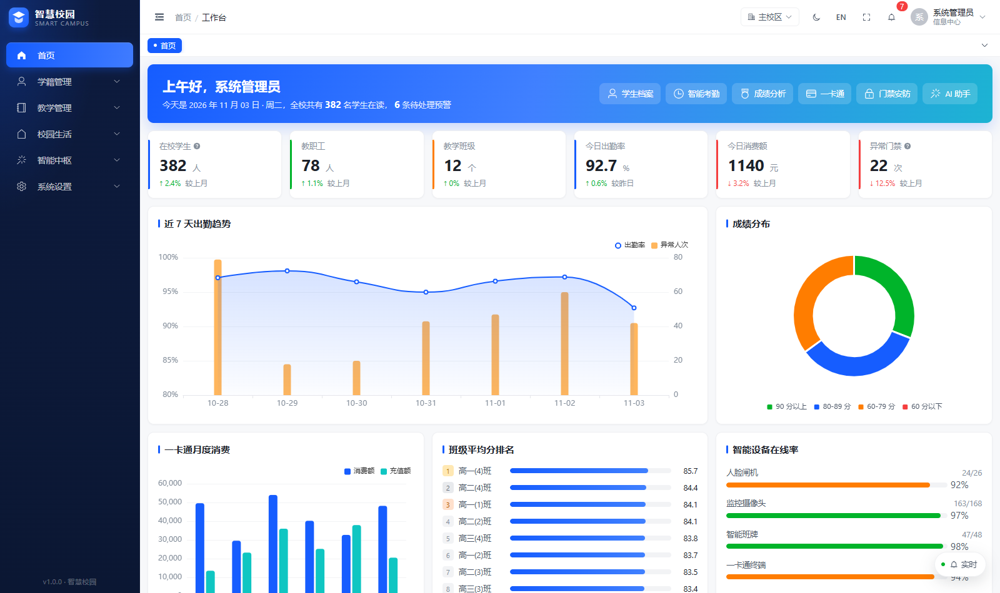
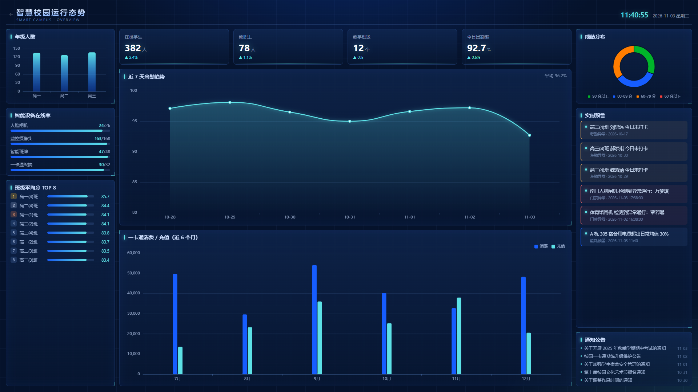
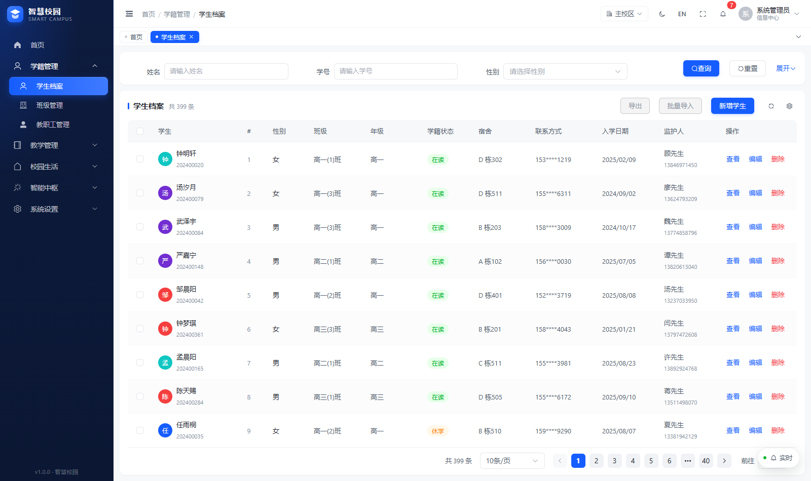
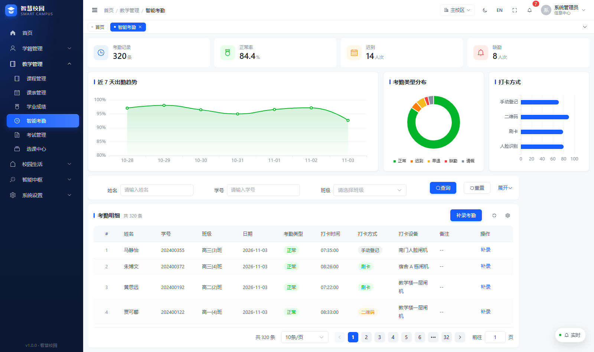
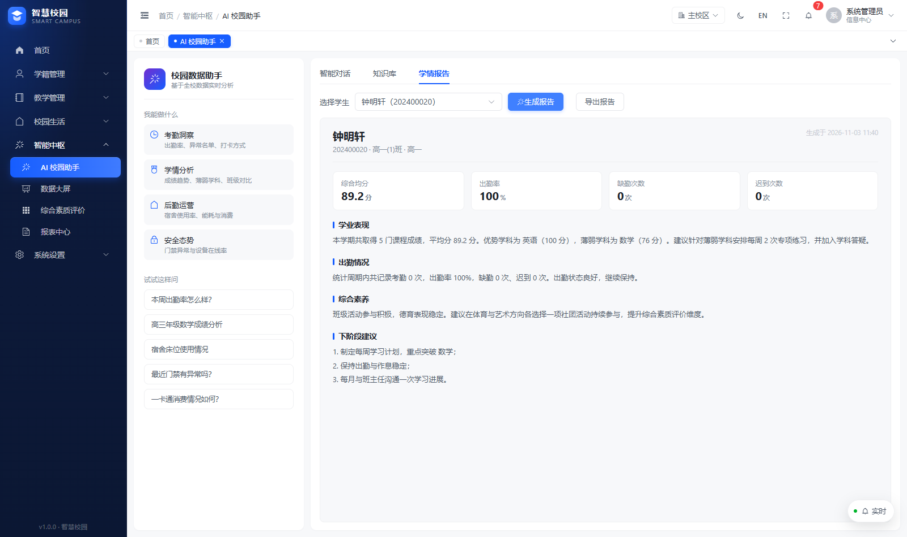
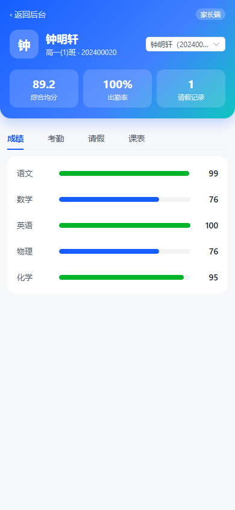

# 智慧校园管理系统（smart-campus）

一套可直接运行的**智慧校园中后台系统**，目录结构、分层方式、共享包契约与配置驱动（Schema DSL）写法，
均参照企业级项目 `rs.ict-saas` 的架构与代码组件实现；在此基础上补齐了从「教务管理」到「校园生活」、
从「数据大屏」到「家长端」的完整业务闭环。

- 前端：Vue 3 + TypeScript + Element Plus + Pinia + Vue Router + ECharts + Less
- 工程：pnpm workspace 单仓多包（monorepo），Vite 构建，Playwright E2E
- 数据：内置 **mock 服务**（axios adapter 层拦截），无后端即可完整体验；切换真实后端零改业务代码

> 演示账号：`admin / 123456`（另有 `principal`、`master01`，密码相同）

---

## 一、与 rs.ict-saas 的架构对应关系

| rs.ict-saas | 本项目 | 说明 |
| --- | --- | --- |
| `@fy/cli` + `@fy/plug-wmf`（Rspack 模块联邦） | Vite + 动态 `import()` + 自定义 `mduAlias` 插件 | 保留「入口只登记模块，模块路由按需加载」的运行时形态 |
| `packages/apps/<app>/entry` | `packages/apps/campus/entry` | 应用入口：bootstrap、路由表、登录守卫、接口中间层、外壳 |
| `packages/apps/<app>/mdus/<mdu>` | `packages/apps/campus/mdus/<mdu>` | 业务模块，一个模块 = 一组路由 + 页面 + 私有组件 |
| `lmAppsGanshutongMdusXsdd/routes` | `lmAppsCampusMdusXsgl/routes` | 模块级导入约定（别名由 Vite 插件生成） |
| `lmCmpsBasic/*`、`lmCmpsBiz/*`、`lmCmpsLayout/*`、`lmCmpsEcharts/*` | 同名 | 基础 / 业务 / 布局 / 图表组件 |
| `lmIreposC/*`、`lmIreposF/*` | 同名 | 表格列渲染器、表单字段工厂 |
| `lmHooks/*`、`lmUtils/*`、`lmStore/*`、`lmLibs/*`、`lmApisGst/*` | `lmHooks` `lmUtils` `lmStore` `lmLibs` `lmApisCampus` | hooks / 工具 / 状态 / 三方库出口 / 接口层 |
| `@fy/hook` 的 `useSimpleCols` / `useSimpleBars` | `lmLibs/schema` | 复刻其 DSL 语法与组件注册表机制 |
| Swagger 自动生成 `$xxxGet/Post` | `packages/apis/campus/api/*` + `mock/` | 相同函数命名风格与 `{ status, result, msg }` 响应结构 |
| `sync()` 错误优先调用 | `lmUtils/promise` | `const [err, res] = await sync(api())` |

**保留的核心约定**

1. 所有共享包通过 `lm` 前缀导入，业务代码不写相对路径跨包引用。
2. 业务模块标准结构：`package.json` + `routes.ts` + `views/<Page>/{index.vue,index.less,config/}`。
3. 列表页由 `NPageBasic`（查询区 + 表格）驱动，列与查询条件用 **DSL 字符串**描述。
4. 表单由 `Form` + `irepos/f` 字段工厂描述，字段天然可序列化。
5. 接口响应统一 `{ status, result, msg }`，由 `entry/plugins/serviceMid.ts` 统一解包与报错。

---

## 二、目录结构

```
smart-campus
├─ e2e/                             # Playwright E2E 用例
├─ scripts/
│  ├─ gen-routes.mjs                # 扫描 mdus/ 生成入口路由表
│  └─ create-module.mjs             # 新建业务模块（等价 fy wmf add）
├─ docs/
│  ├─ config-dsl.md                 # 列/查询/表单 DSL 语法
│  └─ screenshots/                  # 界面截图
└─ packages
   ├─ apis/campus                   # 接口层
   │  ├─ api/*.ts                   # auth/academic/staff/system/enroll/exam/life/report/ai/dashboard
   │  ├─ enums.ts                   # 本地字典兜底
   │  └─ mock/                      # db / extra / extra2 / knowledge / router / adapter
   ├─ apps/campus
   │  ├─ entry                      # bootstrap / routes / plugins / assets
   │  └─ mdus/<37 个业务模块>
   ├─ cmps
   │  ├─ basic    # Form Tb QueryView Dialog NTag Btn ActionGroup NVirtualList ...
   │  ├─ biz      # NPageBasic Menu ToolHeader BreadCrumb TagViews RealtimeFeed ImportPage
   │  ├─ layout   # AppLayout BizApp
   │  └─ echarts  # Echart（跟随主题自动重绘）
   ├─ hooks       # useTb / useSimpleCols / useSimpleBars / useDict / useHandle / socket
   ├─ irepos      # c：列渲染器    f：字段工厂
   ├─ libs        # element-plus/vue-router/pinia 出口 + schema DSL + i18n
   ├─ store       # pinia：app（含校区）/ dict / tags
   └─ utils       # api sync fmt time obj str dom download auth enhanceRoute
```

---

## 三、快速开始

```bash
pnpm install          # 安装依赖（Node >= 20，pnpm >= 9）
pnpm dev              # 开发服务 http://localhost:8080
pnpm build            # 生产构建（含 vue-tsc 类型检查）
pnpm test:e2e         # Playwright E2E（使用本机 Edge，无需下载浏览器）
pnpm test:ai-proxy    # AI 代理契约检查（假上游 + 密钥注入断言）
```

其他命令：

```bash
pnpm typecheck        # 仅类型检查
pnpm gen:routes       # 重新生成路由注册表
pnpm create:module xx "某某管理" 教学管理 course   # 新建业务模块
```

---

## 四、页面如何被「配置」驱动

```vue
<NPageBasic
  title="学生档案"
  :bars="bars"          <!-- 查询条件 -->
  :cols="cols"          <!-- 表格列 -->
  :api="fetchData"
  :is-show-more-filter="true"
  @on-tb-event-watch="onTbAction"
/>
```

```ts
useSimpleCols([
  "select", "idx",
  "姓名|name|text|minWidth:150-fixed:left",
  "学籍状态|status|tag|minWidth:100",          // setComProps: { dictType: "STUDENT_STATUS" }
  "性别|gender|enum-type:GENDER",
  "入学日期|enrollDate|text-format:date-type:ymd-join:2",
  "actions|查看:view-编辑:edit-删除:delete"
]);
```

完整语法见 [docs/config-dsl.md](docs/config-dsl.md)。

---

## 五、模块按需加载

`entry/routes.ts` 只保存「模块 -> 加载器」映射；守卫命中未注册路径时动态 import 模块 `routes.ts` 并
`addRoute`，再 `next({ path, replace: true })` 重新匹配。等价于模块联邦的按需加载，且每个 mdus 独立成 chunk。

---

## 六、接口层与 mock

- `packages/apis/campus/http.ts` 导出 axios 实例；`VITE_USE_MOCK !== "false"` 时挂载 mock adapter。
- mock 在 **adapter 层**拦截，请求/响应拦截器、`sync()`、类型与真实后端完全一致。
- 接入真实后端：`.env` 写入 `VITE_USE_MOCK=false` 并调整 `baseURL`，业务页面零改动。

> 提示：mock 数据在内存中，**刷新页面即重置**；E2E 用例做了状态隔离，不依赖预置数据。

---

## 七、界面预览

| 首页驾驶舱 | 数据大屏 |
| --- | --- |
|  |  |

| 学生档案 | 智能考勤 |
| --- | --- |
|  |  |

| AI 学情报告 | 家长端（移动端） |
| --- | --- |
|  |  |

更多截图见 `docs/screenshots/`。

---

## 八、功能清单

**A 段 · 基础闭环**

| 能力 | 路径 | 说明 |
| --- | --- | --- |
| 登录 / 鉴权 | `/login/` | token、菜单、权限码、字典初始化 |
| 数据字典 | `/zdgl/` | 字典类型 + 字典项增删改，改完即时刷新前端缓存 |
| 菜单与按钮权限 | `/cdgl/` | 角色 → 菜单/按钮树授权，登录下发 `authCodes`，`v-auth` 生效 |
| 消息中心 | `/msg/` | 未读/已读、类型筛选、全部已读，顶栏铃铛联动 |
| 个人中心 | `/grzx/` | 资料、改密码、偏好（密度/默认首页/主题） |
| 批量导入 | `/xsgl/import/` | 模板下载 → 拖拽上传 → 逐行校验 → 只导入有效行 |
| 请假审批 | `/qjgl/` | 发起 → 审批 → **自动写回考勤**，指标卡实时更新 |
| 待办中心 | `/dbzx/` | 跨模块聚合请假审批 / 报修派单 / 访客审核 / 缴费催缴，紧急优先排序，一键跳转处理 |
| 导入导出中心 | `/dzzx/` | 统一入口：4 类导入模板下载、8 类数据一键导出 CSV、导出记录可追溯并重新下载 |

**B 段 · 业务纵深**

| 模块 | 路径 | 模块 | 路径 |
| --- | --- | --- | --- |
| 学生档案 | `/xsgl/` | 教职工 | `/jsgl/` |
| 班级管理 | `/bjgl/` | 课程管理 | `/kcgl/` |
| 课表矩阵 | `/kcb/` | 智能考勤 | `/kqgl/` |
| 学业成绩 | `/cjgl/` | 考试管理 | `/ksgl/` |
| 选课中心 | `/xkzx/` | 综合素质评价 | `/zhsz/` |
| 智慧宿舍 | `/ssgl/` | 宿舍报修 | `/ssbx/` |
| 一卡通 | `/ykt/` | 消费预警 | `/xfyj/` |
| 门禁安防 | `/mjgl/` | 访客预约 | `/fkyy/` |
| 缴费中心 | `/jfzx/` | 资产台账 | `/zctz/` |
| 图书馆 | `/tsjy/` | 校车管理 | `/xcgl/` |
| 能耗监测 | `/nhjc/` | 通知公告 | `/tzgg/` |

**C 段 · 平台能力**

| 能力 | 路径/位置 | 说明 |
| --- | --- | --- |
| 数据大屏 | `/daping/` | 全屏深色看板：KPI、出勤趋势、消费、排名、预警、设备在线率 |
| 报表中心 | `/bbzx/` | 4 张可运行报表 + 条件筛选 + CSV 导出，大结果集走虚拟滚动 |
| AI 助手（Copilot） | `/ai/` | 7 个只读工具路由：学生 / 考勤 / 成绩 / 请假 / 一卡通 / 报修 / 综评，返回结论 + 指标卡 + 明细表 + 追问建议 |
| 知识库 | `/ai/` | 10 条制度文档，关键词打分检索（标题 6 / 标签 4 / 分类 2 / 正文 1） |
| 学情报告 | `/ai/` | 选学生生成结构化报告（4 项指标 + 4 段分析），支持导出 |
| 智能查询 | 列表页查询区 | 「智能查询」按钮：一句话 → 查询条件（`AiQuery` + `/ai/nl2query`），解析结果可视化确认后再应用 |
| 家长周报 | `/parent/` | 按成绩 / 考勤 / 请假 / 综评生成结构化周报（亮点 + 建议） |
| 报表解读 | `/bbzx/` | 运行报表后一键生成结论、关键发现与行动建议 |
| 模型接入层 | `lmApisCampus/ai/provider` | 规则引擎 / OpenAI 兼容 / Ollama 三种 Provider，密钥由 `server/ai-proxy.mjs` 在服务端注入，失败自动降级 |
| 实时推送 | 全局浮窗 | `useRealtime` 事件总线，18s 推送、未读角标、高风险桌面通知 |
| 多校区 | 顶栏 | 主/东湖/北岭三校区切换，概览数据按规模重算并持久化 |
| 审计日志 | `/rzgl/` | 操作人/模块/结果/时间筛选与导出 |
| 家长端 | `/parent/` | 移动端 H5：孩子切换、KPI、成绩/考勤/请假/课表 |

**D 段 · 工程与体验**

| 能力 | 说明 |
| --- | --- |
| E2E | `e2e/app.spec.ts`：登录鉴权、10 个核心模块、审批闭环、CSV 导入、主题与校区切换 |
| 骨架屏 | `Tb` 首次加载展示 `ElSkeleton`，避免空表格闪烁 |
| 虚拟滚动 | `NVirtualList`：仅渲染可视区，报表 399 行时 DOM 内仅 ~22 行 |
| 暗色模式 | `html.dark` 令牌 + Element Plus 暗色变量 + 图表自动重绘，偏好持久化 |
| 国际化 | `lmLibs/i18n`：菜单/分组/外壳文案中英切换，业务页文案保留中文 |
| 响应式 | ≤1024px 侧边栏转抽屉 + 遮罩，内容区自适应 |
| 构建优化 | 图表与组件按需引入 + 三方包拆分（首屏 JS 由 2.2MB 降到 0.9MB，见第九节） |

---

## 九、测试与质量

```bash
pnpm test:unit     # Vitest 单元测试（66 个用例，纯函数层）
pnpm test:e2e      # Playwright 主链路（7 条）
pnpm test:ai-proxy # AI 代理契约检查（密钥注入 / 上游透传 / 兜底 503）
pnpm build         # vue-tsc 类型检查 + 产物构建
```

当前状态：**37 个业务模块 / 280+ 源文件 / 37 条路由全部可访问，控制台 0 错误**。

### 测试分层

| 层 | 工具 | 覆盖 |
| --- | --- | --- |
| 单元 | Vitest（`tests/`） | `nlq`（自然语言→查询条件）、`copilot`（工具路由）、`insight`（报表解读）、`parentReport`（家长周报）、`extractDelta`（流式分片解析） |
| 契约 | Node 脚本 | AI 代理：转发、密钥注入、未配置上游兜底 503 |
| E2E | Playwright（`e2e/`） | 登录鉴权、10 个核心模块、审批闭环、CSV 导入、AI 工具路由、主题与校区切换 |

单测只覆盖**无副作用纯函数**，不做组件快照——这类逻辑最容易改坏，也最适合快速回归（全量 0.5s）。

### CI

`.github/workflows/ci.yml` 分两个 job：

1. **quality**：`pnpm build` → `pnpm test:unit` → `pnpm test:ai-proxy`
2. **e2e**：装 Chromium（`PW_CHANNEL=""` 时 `playwright.config.ts` 不用本机 Edge）→ `pnpm test:e2e` → 失败时上传 `test-results/`

### 构建体积

| 指标 | 优化前 | 当前 | 变化 |
| --- | --- | --- | --- |
| 首屏 JS（entry + 静态依赖） | 2,170 KB | **879 KB** | −59% |
| ECharts chunk | 1,012 KB | 539 KB | −47% |
| Element Plus chunk | 842 KB | 546 KB | −35% |

做法：

1. **ECharts 按需**：`echarts/core` + 只注册 bar/line/pie 与用到的组件（`cmps/echarts/Echart/Echart.vue`）
2. **Element Plus 按需**：去掉 `app.use(ElementPlus)` 全量注册，各页面显式 import；`bootstrap.ts` 只保留 `ElLoading`（v-loading 指令）
3. **移除整包默认导出**：`libs/element-plus.ts` 不再 `export default ElementPlus`——这一行会阻止 tree-shaking，是体积翻倍的主因
4. **manualChunks**：vue / element-plus / echarts 拆成独立 vendor chunk，业务代码变更不影响其缓存

> ⚠️ 维护约定：`libs/element-plus.ts` 只做 `export *`，**不要加默认导出**；新增组件直接 `import { ElXxx } from "lmLibs/element-plus"` 即可。

AI 能力的工具清单、模型切换方式与合规约束见 [docs/ai.md](docs/ai.md)。

E2E 覆盖范围见 `e2e/app.spec.ts`；如需在 CI 运行，安装 Playwright 浏览器或复用本机 Edge
（`playwright.config.ts` 中 `channel: "msedge"`）。

---

## 十、相比参考项目的简化说明

| 参考项目 | 本项目处理方式 | 原因 |
| --- | --- | --- |
| Rspack 模块联邦（跨仓库远程模块） | Vite 动态导入 + 别名注册表 | 私有插件不可用；单仓内行为等价，可平滑替换为 federation |
| Swagger 生成接口代码 | 手写同名风格接口 + 内存 mock | 无后端契约；调用方式保持一致 |
| 70+ 基础组件 / 54 业务组件 | 抽取高频核心组件 | 覆盖主要页面形态，其余按同一契约扩展 |
| BPM 流程设计器 | 请假审批的最小闭环（申请/审批/记录） | 演示流程能力，未引入 bpmn 设计器 |
| 完整 i18n 方案 | 外壳层中英切换 | 业务文案量大，保留扩展点 |
| 多租户数据隔离 | 校区切换（数据按规模缩放） | 演示切换形态，未做服务端隔离 |

---

## 十一、后续可扩展方向

- 用 `@module-federation/vite` 替换 `mduAlias`，接入真实远程模块
- 把 mock 替换为真实网关，补齐接口契约测试
- 引入 bpmn 流程设计器，把请假审批扩展为可配置工作流
- 大屏接入 WebSocket 真推流，图表增加实时帧动画
